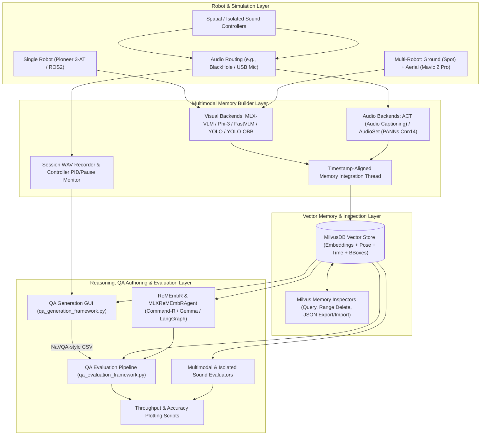

# ReMEmbR: Multimodal & Multi-Robot Long-Horizon Spatio-Temporal Memory for Robots

<p align="center">
  <a href="https://arxiv.org/abs/2409.13682">Original ReMEmbR Paper</a> •
  <a href="https://nvidia-ai-iot.github.io/remembr">Project Website</a> •
  <a href="#system-architecture">Architecture</a> •
  <a href="#prerequisites--installation">Setup</a> •
  <a href="#supported-model-backends">Backends</a> •
  <a href="#workflows--usage">Usage</a> •
  <a href="#evaluation--benchmarking">Evaluation</a>
</p>

**ReMEmbR** builds and reasons over long-horizon spatio-temporal robot memories using Vision-Language Models (VLMs), Audio-Language / Audio Tagging Models (ALMs), Object Detectors, Vector Databases, and Large Language Model (LLM) agents.

Building on NVIDIA's original [ReMEmbR](https://github.com/NVIDIA-AI-IOT/remembr), this repository expands the framework into a **multimodal (visual + audio), heterogeneous multi-robot, and Apple Silicon (MLX / MPS) accelerated** memory building, question-answering, navigation, and evaluation platform for Webots simulations and ROS2 robots.

---

## Key Capabilities

- **Multimodal Spatio-Temporal Memory**: Synchronizes visual scene captions and object detections with real-time environmental audio captions/tags, robot 3D poses `(x, y, z)`, headings `theta`, and full-precision Unix timestamps inside **MilvusDB**.
- **Single-Robot & Heterogeneous Multi-Robot Operation**:
  - **Single-Robot Mode**: Supports ground robot trajectories (e.g., Pioneer 3-AT in Webots or Nova Carter in ROS2).
  - **Multi-Robot Mode**: Simultaneously ingests streams from a **Ground Robot (Spot)** and an **Aerial Drone (Mavic 2 Pro)** with independent or shared visual backends (e.g., standard `xyxy` YOLO bounding boxes on the ground and 8-point `YOLO-OBB` oriented bounding boxes from the air) alongside shared session audio.
- **Native Apple Silicon (MLX & MPS) Acceleration**: Runs quantized VLMs (`mlx-vlm`) and tool-calling RAG agents (`mlx-lm`) natively on Apple Silicon, while retaining compatibility with CUDA/Linux, Ollama, OpenAI, and NVIDIA NIM endpoints.
- **Rich Memory Management CLI**: Inspect, search, slice/delete ranges, and portably export/import collections (with optional 1024-D embedding vectors and bounding-box metadata) as JSON snapshots.
- **Interactive QA Dataset Generation GUI**: Step through recorded trajectories in a Tkinter application (`qa_generation_framework.py`) featuring nearest-timestamp camera frame previews, per-entry and full-session WAV waveform visualization/seeking, and NaVQA-compatible CSV export.
- **End-to-End Benchmarking & Analytics**:
  - **QA Evaluation Pipeline** (`qa_evaluation_framework.py`): Scores Spatial (`L2 <= 15 m`), Temporal (`L1 <= 2 min`), and Descriptive (exact binary + OpenAI LLM judge / heuristic fallback) question families.
  - **Scenario-Aware & Isolated Sound Evaluation** (`run_evaluation_pipeline.sh`): Evaluates spatial coverage, content accuracy, retrieval relevance, and individual sound-source contributions against Webots ground truth.
  - **Throughput & Accuracy Visualization**: Publication-ready plotting scripts for model inference rates, memory footprint vs. throughput, and cross-model QA family accuracy comparisons.

---

## System Architecture



---

## Repository Structure

```text
remembr/
├── remembr/                                      # Core Python library
│   ├── agents/
│   │   ├── agent.py                              # Base agent interface
│   │   ├── remembr_agent.py                      # LangGraph agent (Ollama / OpenAI / NVIDIA NIM)
│   │   ├── mlx_remembr_agent.py                  # MLX native agent (Command-R / Gemma)
│   │   ├── mlx_remembr_agent_multimodal.py       # MLX agent reasoning over visual + audio captions
│   │   ├── mlx_remembr_agent_langchain_langgraph*.py # LangGraph tool-calling wrappers for MLX
│   │   ├── non_agent.py                          # Text-context baseline agent
│   │   └── vlm_non_agent.py                      # VLM multi-frame baseline agent
│   ├── captioners/
│   │   ├── captioner.py                          # Base captioner interface
│   │   ├── phi3_vision_mlx_captioner*.py         # Phi-3-Vision MLX captioners (standard & advanced)
│   │   ├── mlx_llava_captioner.py                # MLX LLaVA captioner
│   │   ├── mac_native_captioner.py               # Apple Silicon MPS BLIP / CLIP captioner
│   │   └── vila_captioner*.py                    # NVlabs VILA captioners (CUDA & MPS)
│   ├── memory/
│   │   ├── memory.py                             # Base Memory & MemoryItem definitions
│   │   ├── memory_multimodal*.py                 # Multimodal, BB/OBB, and multi-robot MemoryItems
│   │   ├── milvus_memory.py                      # Standard Milvus vector memory backend
│   │   ├── milvus_memory_multimodal.py           # Multimodal (visual + audio) Milvus backend
│   │   ├── milvus_memory_multimodal_BB_OBB.py    # Multimodal Milvus backend with YOLO bbox storage
│   │   └── milvus_memory_multimodal_multirobot.py# Multi-robot (ground + aerial) Milvus backend
│   ├── prompts/                                  # System and generation prompt templates
│   ├── tools/                                    # LangChain spatial/temporal/text retrieval tools
│   ├── utils/                                    # Vector retriever and formatting utilities
│   └── scripts/                                  # Upstream CODa / NaVQA preprocessing & eval scripts
│
├── launch_multimodal_memory_with_disk_space.sh   # Single-robot multimodal memory launcher
├── launch_multimodal_memory_multirobot.sh        # Multi-robot (ground + aerial) memory launcher
├── launch_milvus_container.sh                    # Standalone Docker MilvusDB management script
│
├── memory_build_enhanced_multimodal_with_disk_space.py # Single-robot multimodal memory builder
├── memory_build_enhanced_multimodal_multirobot.py      # Multi-robot multimodal memory builder
├── milvus_memory_inspector_multimodal.py         # Single-robot Milvus CLI inspector & JSON porter
├── milvus_memory_inspector_multimodal_OB_OBB.py  # BBox/OBB-aware single-robot Milvus CLI inspector
├── milvus_memory_inspector_multimodal_multirobot.py    # Multi-robot Milvus CLI inspector & JSON porter
├── repair_memory_timestamps.py                   # Utility to repair coarse legacy timestamps
├── query_remember.py                             # Interactive CLI for querying MLXReMEmbRAgent
│
├── qa_generation_framework.py                    # Tkinter GUI for authoring trajectory QA CSVs
├── qa_evaluation_framework.py                    # Automated Spatial/Temporal/Descriptive QA evaluator
├── run_qa_evaluation_pipeline.sh                 # Shell wrapper for QA benchmark runs
│
├── run_evaluation_pipeline.sh                    # End-to-end multimodal + isolated sound benchmark
├── ground_truth_labeler.py                       # Extracts ground truth from Webots world/controllers
├── memory_content_analyzer.py                    # Categorizes & clusters stored visual/audio memories
├── multimodal_evaluation_framework.py            # Evaluates coverage, retrieval, and navigation
├── isolated_sound_evaluator.py                   # Evaluates individual sound-source effectiveness
├── spatial_sound_controller.py                   # Distance-attenuated spatial sound playback controller
│
├── compare_qa_family_accuracies.py               # Grouped bar charts across QA evaluation JSON reports
├── visualize_model_stats.py                      # Plots VLM/ALM throughput & model size stats (auto single/multi)
├── visualize_model_stats_multirobot.py           # Dedicated multi-robot session stats plotter
│
├── examples/
│   ├── chat_demo/                                # Offline ROS2 bag Gradio web demo
│   └── nova_carter_demo/                         # Live NVIDIA Nova Carter Isaac ROS2 nodes & Dockerfiles
└── tests/
    └── test_qa_generation_framework.py           # Headless unit tests for QA generation components
```

---

## Prerequisites & Installation

### 1. Clone and Install Core Package

```bash
git clone <REPO_URL> remembr
cd remembr

conda create -n remembr python=3.10 -y
conda activate remembr

pip install -r requirements.txt
pip install -e .
```

### 2. Install Platform & Modality Packages

For **Apple Silicon (MLX) multimodal memory building, YOLO detection, and audio capture**:

```bash
# Apple Silicon LLM & VLM runtimes
pip install mlx mlx-lm
pip install mlx-vlm --no-deps
pip install "opencv-python>=4.12.0.88"

# Object detection, audio processing, and plotting
pip install ultralytics librosa pyaudio soundfile matplotlib seaborn pandas
```

> **macOS Audio Routing Note:** To capture simulated Webots audio directly into the memory builder, install [BlackHole](https://existential.audio/blackhole/) (e.g., `brew install blackhole-2ch`) and set BlackHole as the output/multi-output audio device. The memory builders default to `--audio-device BlackHole`.

### 3. Start MilvusDB

Docker must be running. Use the included standalone launcher script to start Milvus on port `19530`:

```bash
bash launch_milvus_container.sh start
# Verify Milvus is listening:
nc -z 127.0.0.1 19530
```

### 4. External Repositories & Path Configuration

Several optional visual/audio backends and simulation scripts integrate with sibling repositories on your machine. Rather than assuming a fixed username, the table below uses `$HOME` (`~`) to show the default directory layout expected by the scripts:

| External Repository / Directory | Purpose & Flag | Expected Checkpoints / Contents |
| :--- | :--- | :--- |
| `~/ACT` | **Audio Captioning Transformer** (`--audio-backend ACT`) | `models/TransModel.py`, `tools/config_loader.py`, pretrained ACT weights |
| `~/audioset_tagging_cnn` | **PANNs AudioSet Tagging CNN** (`--audio-backend AUDIOSET`) | [qiuqiangkong/audioset_tagging_cnn](https://github.com/qiuqiangkong/audioset_tagging_cnn) + `~/audioset_tagging_cnn/Cnn14_mAP=0.431.pth` |
| `~/ml-fastvlm` | **Apple FastVLM** (`--visual-backend FASTVLM`) | [apple/ml-fastvlm](https://github.com/apple/ml-fastvlm) + `checkpoints/llava-fastvithd_0.5b_stage3` |
| `~/Phi-3-Vision-MLX` | **Phi-3-Vision MLX** (`--visual-backend PHI3`) | Phi-3-Vision MLX package + quantized weights in `./models/phi3_v_Q` |
| `~/ultralytics` | **Custom Ultralytics YOLO Weights** (`--visual-backend YOLO` / `YOLO-OBB`) | Ground: `trained models/obi_detect/yolo26x-best-custom.pt` (or `./yolo26x.pt`)<br>Aerial: `trained models/obb_detect/yolo26x-obb-custom-trained.pt` |
| `~/Documents/Webots Sims/vehicles` | **Webots Worlds & Controllers** | `.wbt` world files (`worlds/`) and robot/sound controllers (`controllers/`) |
| `./deps/VILA` | **NVlabs VILA** (Upstream ROS2 / NaVQA captioning) | [NVlabs/VILA](https://github.com/NVlabs/VILA) (installed via `./vila_setup.sh remembr`) |

> **Portability Note:** Several shell launchers and Python scripts define local path variables at the top of the file (such as `PYTHONPATH`, `act_path`, `audioset_tagging_cnn_path`, `fastvlm_path`, `WORLD_FILE`, and YOLO `model_path`). When setting up on a new machine, update those path constants to point to your own `$HOME` or workspace locations:
> ```bash
> export PYTHONPATH="$HOME/remembr:$HOME/ACT:$PYTHONPATH"
> ```

---

## Supported Model Backends

### Visual Backends (`--visual-backend`)

| Backend Identifier | Type | Description |
| :--- | :--- | :--- |
| `PHI3` | MLX VLM | Local quantized Phi-3-Vision captioner (`--advanced` enables detailed spatial prompts) |
| `FASTVLM` | PyTorch / MPS VLM | Apple FastVLM (`llava-fastvithd_0.5b_stage3`) |
| `GEMMA-3N` | MLX VLM | Gemma 3n vision-language captioner |
| `YOLO` | Object Detector | Axis-aligned `[x1, y1, x2, y2]` detection + synthesized text caption + frame annotation |
| `YOLO-OBB` | Oriented Detector | 8-point `[x1, y1, ..., x4, y4]` oriented bounding boxes for aerial imagery |
| `<HuggingFace-Model-ID>` | `mlx-vlm` | Any `mlx-vlm`-compatible HuggingFace repository ID (see tested models below) |

**Tested `mlx-vlm` HuggingFace Models:**
- **Gemma 4**: `mlx-community/gemma-4-E2B-it-qat-4bit`, `lmstudio-community/gemma-4-E2B-it-MLX-4bit`, `harishkumar12k/gemma-4-E2B-it-mlx-2Bit`, `mlx-community/gemma-4-E4B-it-qat-4bit`, `mlx-community/gemma-4-12B-it-qat-4bit`
- **SmolVLM / SmolVLM2**: `mlx-community/SmolVLM-256M-Instruct-bf16`, `mlx-community/SmolVLM-500M-Instruct-bf16`, `mlx-community/SmolVLM-Instruct-4bit`, `smdesai/SmolVLM2-2.2B-Instruct-4bit`, `mlx-community/SmolVLM2-2.2B-Instruct-mlx`
- **MiniCPM-V**: `mlx-community/MiniCPM-V-4.6-4bit`, `mlx-community/MiniCPM-V-4.6-8bit`, `mlx-community/MiniCPM-V-4.6-bf16`
- **Qwen3-VL / Qwen3.5**: `mlx-community/Qwen3-VL-2B-Instruct-8bit`, `lmstudio-community/Qwen3.5-0.8B-MLX-4bit`, `lmstudio-community/Qwen3.5-2B-MLX-4bit`
- **InternVL / LLaVA / Idefics / Moondream**: `mlx-community/InternVL3-2B-4bit`, `mlx-community/InternVL3-8B-MLX-4bit`, `Dadm-n/InternVL3_5-2B-mlx`, `mlx-community/llava-v1.6-mistral-7b-4bit`, `mlx-community/idefics2-8b-4bit`, `beshkenadze/moondream3-preview-mlx-4bit`

### Audio Backends (`--audio-backend`)

| Backend Identifier | Model Architecture | Output Style |
| :--- | :--- | :--- |
| `ACT` | Audio Captioning Transformer | Natural-language descriptions (e.g., *"A siren wailing in the distance"*) |
| `AUDIOSET` | PANNs `Cnn14` (`mAP=0.431`) | Top-k confidence-scored AudioSet event tags (e.g., *"Emergency vehicle, Siren, Traffic noise"*) |

### Reasoning / RAG Agent Backends (`--model-backend` / `llm_type`)

- **MLX Native (`MLXReMEmbRAgent` / `qa_evaluation_framework.py`)**:
  - `COMMAND_R`: `mlx-community/c4ai-command-r-v01-4bit`
  - `GEMMA`: `mlx-community/gemma-4-E2B-it-qat-4bit` (or `mlx-community/gemma-3n-E2B-it-lm-4bit` in navigation agents)
- **LangGraph Upstream (`ReMEmbRAgent`)**:
  - Supports Ollama (`command-r`, `llama3.1:8b`, etc.), OpenAI (`gpt-4o`), and NVIDIA NIM endpoints.

---

## Workflows & Usage

### 1. Single-Robot Multimodal Memory Building

Watches `/tmp/webots_memory` for incoming robot frames/pose JSONs and records synchronized session audio to `/tmp/webots_memory_audio`. At shutdown, session throughput and model disk sizes are appended to `model_session_stats.csv`.

```bash
# Launch with an MLX-VLM HuggingFace model and ACT audio captioning
./launch_multimodal_memory_with_disk_space.sh \
  --collection webots_sounds_multimodal \
  --audio-backend ACT \
  --visual-backend mlx-community/gemma-4-E2B-it-qat-4bit

# Launch with YOLO object detection and store bounding boxes in Milvus
./launch_multimodal_memory_with_disk_space.sh \
  --collection webots_sounds_multimodal \
  --audio-backend AUDIOSET \
  --visual-backend YOLO \
  --bbox

# Check external HuggingFace model drive capacity before launching
./launch_multimodal_memory_with_disk_space.sh --show-disk-space
```

### 2. Multi-Robot Multimodal Memory Building (Ground + Aerial)

Processes synchronized data from a **Ground Robot** (`/tmp/webots_memory_ground`) and an **Aerial Robot** (`/tmp/webots_memory_aerial`) alongside shared audio. Appends run metrics to `model_session_stats_multirobot.csv`. See [MULTIROBOT_README.md](./MULTIROBOT_README.md) for controller details.

```bash
# Default YOLO (ground xyxy) + YOLO-OBB (aerial oriented polygons) + ACT audio
./launch_multimodal_memory_multirobot.sh \
  --collection webots_sounds_multimodal_multirobot_obj_detections \
  --audio-backend ACT \
  --visual-backend YOLO

# Use a shared MLX VLM across both ground and aerial robots with AudioSet tagging
./launch_multimodal_memory_multirobot.sh \
  --collection webots_sounds_multimodal_multirobot \
  --audio-backend AUDIOSET \
  --visual-backend mlx-community/SmolVLM-256M-Instruct-bf16

# Assign distinct visual backends per robot role
./launch_multimodal_memory_multirobot.sh \
  --collection custom_multirobot_session \
  --visual-backend-ground YOLO \
  --visual-backend-aerial mlx-community/MiniCPM-V-4.6-4bit \
  --audio-backend ACT
```

### 3. Inspecting, Exporting & Importing Milvus Collections

Use `milvus_memory_inspector_multimodal.py` (single-robot) or `milvus_memory_inspector_multimodal_multirobot.py` (multi-robot) to manage stored memories:

```bash
# View recent items in table or detailed format
python milvus_memory_inspector_multimodal.py \
  --collection webots_sounds_multimodal \
  --recent 50 \
  --format detailed

# Multi-robot: filter by robot role ("ground" or "aerial")
python milvus_memory_inspector_multimodal_multirobot.py \
  --collection webots_sounds_multimodal_multirobot \
  --robot aerial \
  --format table

# Export a full collection snapshot to JSON (including 1024-D embeddings)
python milvus_memory_inspector_multimodal_multirobot.py \
  --collection webots_sounds_multimodal_multirobot \
  --export-json \
  --include-embeddings

# Import a saved JSON snapshot into a clean collection
python milvus_memory_inspector_multimodal_multirobot.py \
  --collection webots_sounds_multimodal_multirobot \
  --import-json ./memory_export_session.json \
  --clear-before-import

# Delete specific table index ranges or reset an entire collection
python milvus_memory_inspector_multimodal.py \
  --collection webots_sounds_multimodal \
  --delete-range "1:45"

python milvus_memory_inspector_multimodal.py \
  --collection webots_sounds_multimodal \
  --reset
```

### 4. Querying Memories via Python API or CLI

#### Interactive MLX Query CLI

```bash
python query_remember.py --collection webots_sounds_multimodal
# Or run a single query non-interactively:
python query_remember.py -c webots_sounds_multimodal -q "Where did I hear a siren?"
```

#### Python API (Multimodal MLX Agent)

```python
from remembr.memory.milvus_memory_multimodal import MilvusMemory
from remembr.agents.mlx_remembr_agent_multimodal import MLXReMEmbRAgent

memory = MilvusMemory("webots_sounds_multimodal", db_ip="127.0.0.1")
agent = MLXReMEmbRAgent(model_backend="COMMAND_R")
agent.set_memory(memory)

response = agent.query("Go to where I heard car honking")
print("Target Position:", response.position)
print("Reasoning:", response.text)
```

#### Python API (Upstream LangGraph Agent)

```python
from remembr.memory.memory import MemoryItem
from remembr.memory.milvus_memory import MilvusMemory
from remembr.agents.remembr_agent import ReMEmbRAgent

memory = MilvusMemory("test_collection", db_ip="127.0.0.1")
memory.reset()
memory.insert(MemoryItem(caption="I see a desk", time=1.1, position=[0.0, 0.0, 0.0], theta=3.14))

agent = ReMEmbRAgent(llm_type="command-r")
agent.set_memory(memory)
response = agent.query("Where can I sit?")
print(response.position, response.text)
```

### 5. Interactive QA Dataset Generation (`qa_generation_framework.py`)

Launches a Tkinter GUI to step through single-robot or multi-robot trajectories, inspect matched camera frames, play/seek per-entry or full-session WAV audio waveforms, and author NaVQA-formatted QA pairs (`binary`, `position`, `time`, `text`, `duration`). Trajectory durations are automatically bucketed into UUID prefixes (`SHORT` < 2 min, `MEDIUM` 2–7 min, `LONG` > 7 min).

```bash
# Single-robot QA authoring from Milvus (with optional existing CSV to edit)
python qa_generation_framework.py \
  --mode single \
  --source milvus \
  --collection webots_sounds_multimodal \
  --image-dir /tmp/webots_memory \
  --audio-dir /tmp/webots_memory_audio \
  --image-max-delta 8.0

# Multi-robot QA authoring (side-by-side ground & aerial views)
python qa_generation_framework.py \
  --mode multi \
  --source milvus \
  --collection webots_sounds_multimodal_multirobot \
  --ground-image-dir /tmp/webots_memory_ground \
  --aerial-image-dir /tmp/webots_memory_aerial \
  --audio-dir /tmp/webots_memory_audio \
  --image-max-delta 8.0 \
  --load-csv ./existing_qa_set.csv
```

---

## Evaluation & Benchmarking

### 1. QA Evaluation Pipeline (`qa_evaluation_framework.py`)

Evaluates NaVQA-formatted CSV question sets against Milvus gold timestamps/positions and model predictions across three question families:
- **Spatial**: Euclidean (`L2`) distance between predicted and gold `(x, y, z)` coordinates (correct if `<= 15.0 m`).
- **Temporal**: Absolute (`L1`) error in minutes (correct if `<= 2.0 min`).
- **Descriptive**: Exact match for `yes`/`no` binary questions; OpenAI LLM judge (`OPENAI_API_KEY`) or deterministic sequence-similarity fallback (`--judge-backend heuristic`) for open-ended text answers.

```bash
# Evaluate using the convenience pipeline wrapper
export OPENAI_API_KEY="your-api-key"

MODEL_BACKEND=COMMAND_R JUDGE_BACKEND=openai \
  ./run_qa_evaluation_pipeline.sh \
  ./qa_dataset.csv \
  qa_evaluation_report.json \
  webots_sounds_multimodal_multirobot \
  --count-unanswered-as-wrong

# Direct CLI invocation (supports COMMAND_R, GEMMA, SERVICE, or MOCK)
python qa_evaluation_framework.py \
  --csv-path ./qa_dataset.csv \
  --milvus-collection webots_sounds_multimodal \
  --model-backend GEMMA \
  --judge-backend auto \
  --count-unanswered-as-wrong \
  --output ./qa_evaluation_report.json
```

### 2. Multimodal & Isolated Sound Evaluation Pipeline

Runs ground-truth extraction from Webots `.wbt` world files, memory content analysis, scenario-aware retrieval/navigation testing, isolated sound source benchmarking, and HTML report generation:

```bash
./run_evaluation_pipeline.sh --model-backend COMMAND_R
```

### 3. Visualization & Cross-Model Comparison

```bash
# Compare Spatial, Temporal, and Descriptive QA accuracies across multiple runs
python compare_qa_family_accuracies.py \
  --json-files run1/qa_evaluation_report.json run2/qa_evaluation_report.json \
  --labels "ALM: ACT, VLM: SmolVLM, RAG: Command-R" "ALM: ACT, VLM: Gemma-4, RAG: Gemma-4" \
  --output family_accuracy_comparison.png

# Generate model throughput, latency, and footprint charts (auto-detects single vs. multi-robot CSV)
python visualize_model_stats.py \
  --input model_session_stats_multirobot.csv \
  --output ./model_stats_visualizations_multirobot
```

### 4. Upstream ROS2 Demos & CODa / NaVQA Benchmark

- **Offline ROS2 Bag Gradio Demo**: Run `python examples/chat_demo/demo.py` to load a ROS2 bag and chat with ReMEmbR in your browser.
- **Live NVIDIA Nova Carter Demo**: See [examples/nova_carter_demo/README.md](./examples/nova_carter_demo/README.md) for Isaac ROS navigation, `memory_builder_node.py`, `captioner_node.py`, `agent_node.py`, and WhisperTRT `asr_node.py`.
- **CODa / NaVQA Dataset Evaluation**: See [eval.md](./eval.md) for downloading, captioning, and evaluating on the NaVQA dataset.

---

## Running Tests

Headless unit tests cover trajectory duration bucketing (`SHORT` / `MEDIUM` / `LONG`), JSON export loading, nearest-timestamp image indexing, and NaVQA CSV serialization:

```bash
pytest tests/
```

---

## Additional Documentation

- [MULTIROBOT_README.md](./MULTIROBOT_README.md) — Detailed multi-robot (Spot + Mavic 2 Pro) data flow, schemas, and controller setup.
- [YOLO_BACKEND_IMPLEMENTATION.md](./YOLO_BACKEND_IMPLEMENTATION.md) — YOLO / YOLO-OBB visual backend design and detection schema.
- [MLX_TOOL_CALLING_FIX.md](./MLX_TOOL_CALLING_FIX.md) — Structured JSON tool-call prompting and fallback parsing for MLX models.
- [EVALUATION_UPDATES.md](./EVALUATION_UPDATES.md) & [eval_pipeline_explained.md](./eval_pipeline_explained.md) — Deep dive into multimodal retrieval, navigation scoring, and position parsing.
- [eval.md](./eval.md) — Original CODa / NaVQA dataset evaluation instructions.
- [examples/nova_carter_demo/README.md](./examples/nova_carter_demo/README.md) — Live ROS2 deployment on NVIDIA Nova Carter.

---

## Third-Party Software & License

Please refer to [LICENSE.md](./LICENSE.md) (BSD 2-Clause) for terms governing code authored in this repository. This project integrates with third-party open-source software and model weights whose respective licenses should be reviewed before use:

1. **MilvusDB**: https://github.com/milvus-io/milvus
2. **LangGraph / LangChain**: https://langchain-ai.github.io/langgraph/
3. **Apple MLX / MLX-LM / MLX-VLM**: https://github.com/ml-explore/mlx & https://github.com/Blaizzy/mlx-vlm
4. **Ultralytics YOLO**: https://github.com/ultralytics/ultralytics
5. **ACT (Audio Captioning Transformer)** & **PANNs (`audioset_tagging_cnn`)**: https://github.com/qiuqiangkong/audioset_tagging_cnn
6. **Apple FastVLM**: https://github.com/apple/ml-fastvlm
7. **NVlabs VILA**: https://github.com/NVlabs/VILA
8. **WhisperTRT**: https://github.com/NVIDIA-AI-IOT/whisper_trt
9. **Webots**: https://cyberbotics.com/
10. **ROS2 `rclpy`** & **Gradio**: https://github.com/ros2/rclpy & https://github.com/gradio-app/gradio

### Citation

If you build upon ReMEmbR in academic work, please cite the original paper:

```bibtex
@article{anwar2024remembr,
  title={ReMEmbR: Building and Reasoning Over Long-Horizon Spatio-Temporal Memory for Robots},
  author={Anwar, Abrar and Welsh, John and Biswas, Joydeep and Poupart, Pascal and Birchfield, Stan},
  journal={arXiv preprint arXiv:2409.13682},
  year={2024}
}
```
